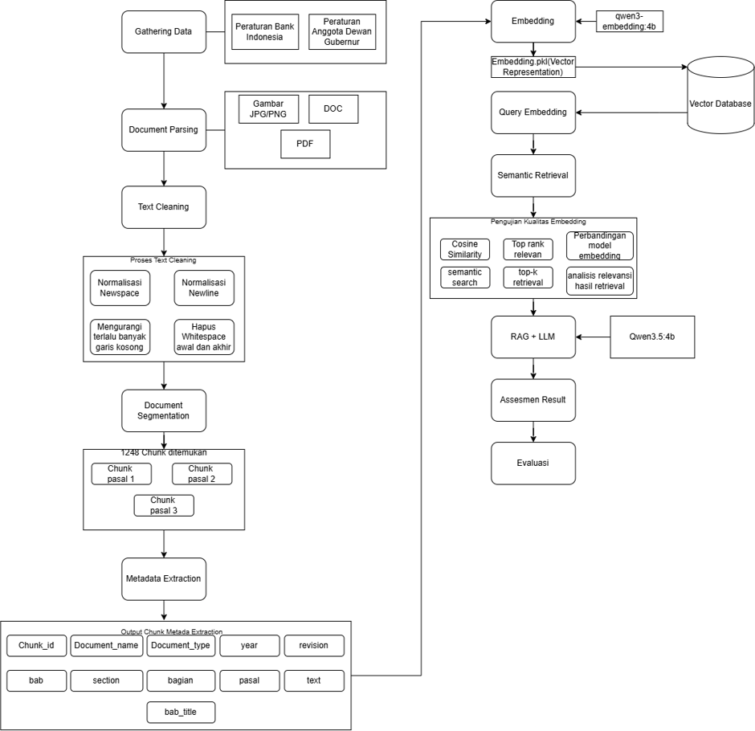

# Usecase 02 – Asesmen Kecukupan Juknis

### Technical Guideline Adequacy Assessment

## Description

Usecase 02 merupakan sistem berbasis Artificial Intelligence (AI) yang dikembangkan untuk membantu proses **asesmen kecukupan Petunjuk Teknis (Juknis)** terhadap kriteria dan sub-kriteria yang telah ditentukan.

Sistem memanfaatkan pendekatan **Natural Language Processing (NLP)**, **semantic retrieval**, **text embedding**, dan **Large Language Model (LLM)** untuk mengidentifikasi serta menganalisis evidence yang relevan dari dokumen Juknis dan regulasi terkait.

Secara umum, sistem bekerja dengan mengolah dokumen sumber menjadi potongan teks (*chunks*), menghasilkan representasi embedding, melakukan pencarian semantik terhadap evidence yang relevan, kemudian menggunakan hasil retrieval sebagai konteks untuk proses assessment.

### Main Workflow



### Main Capabilities

* Ekstraksi teks dari dokumen PDF.
* Pembersihan dan normalisasi teks.
* Segmentasi dokumen berdasarkan struktur dokumen.
* Ekstraksi metadata dokumen dan chunk.
* Pembentukan vector embedding untuk representasi semantik.
* Semantic retrieval untuk menemukan evidence yang relevan.
* Pencarian evidence dari dokumen Juknis dan regulasi.
* Assessment berbasis sub-kriteria.
* Pemberian status dan skor assessment.
* Penyajian hasil assessment untuk mendukung proses review.

### Source Components

| Component                 | Description |
|---------------------------|-------------|
| `s01_parser.py`           | Melakukan ekstraksi teks dari dokumen PDF dan menangani proses OCR apabila diperlukan. |
| `s02_cleaner.py`          | Membersihkan dan menormalisasi teks hasil ekstraksi agar dapat diproses pada tahap berikutnya. |
| `s03_chunker.py`          | Membagi dokumen menjadi beberapa *chunk* berdasarkan struktur dokumen seperti BAB, Bagian, Pasal, dan subbagian. |
| `s04_metadata.py`         | Mengidentifikasi dan menghasilkan metadata dokumen dan *chunk*, seperti jenis dokumen, tahun, revisi, dan identitas *chunk*. |
| `s05_embedder.py`         | Menghasilkan representasi *vector embedding* dari setiap *chunk* menggunakan model embedding. |
| `s06_similarity.py`       | Menghitung tingkat kemiripan semantik antara query dan *chunk* menggunakan *similarity measure*. |
| `s07_llm.py`              | Memproses evidence hasil retrieval menggunakan Large Language Model (LLM) untuk menghasilkan assessment berdasarkan sub-kriteria yang ditentukan. |
| `assessment_retriever.py` | Melakukan *semantic retrieval* untuk mencari dan mengumpulkan evidence Juknis serta regulasi yang relevan terhadap setiap sub-kriteria assessment. |
| `assessment.py`           | Mengatur proses asesmen berdasarkan evidence yang diperoleh dan sub-kriteria yang telah ditentukan. |
| `rubric.py`               | Mendefinisikan kriteria, sub-kriteria, dan bobot yang digunakan sebagai dasar penilaian assessment. |
| `scoring.py`              | Menghitung skor assessment berdasarkan hasil penilaian, bobot sub-kriteria, dan ketentuan perhitungan skor. |
| `build_database.py`       | Membangun database baru dari dokumen yang telah diproses, termasuk pembentukan data dan embedding yang akan digunakan dalam sistem. |
| `save_database.py`        | Menyimpan hasil database yang telah dibangun ke direktori database agar dapat digunakan kembali oleh sistem. |
| `pipeline.py`             | Mengintegrasikan dan mengatur seluruh tahapan pemrosesan dokumen, retrieval, assessment, dan scoring menjadi satu alur pipeline. |
| `main.py`                 | Menjadi *entry point* utama untuk menjalankan pipeline sistem. |
| `exporter.py`              | Mengekspor hasil assessment dan informasi terkait ke dalam format Excel untuk kebutuhan dokumentasi dan analisis lebih lanjut. |                                                                      |

## Getting Started

### Dependencies

Sistem dikembangkan dan diuji menggunakan lingkungan berikut:

* Windows 10/11
* Python 3.13.7
* Ollama
* PyMuPDF
* NumPy
* Pandas
* Qwen-Embedding:4b
* Large Language Model (LLM): Qwen3.5:4b [Maximum Output Tokens: 2048,Context Window: 32,768 tokens]
* Streamlit

Model AI yang digunakan dalam pipeline meliputi model **text embedding** dan **Large Language Model (LLM)** yang dijalankan melalui Ollama.

> Versi dependency dapat berubah mengikuti konfigurasi pengembangan terbaru. Gunakan `requirements.txt` sebagai referensi utama untuk dependency Python.

### Installing
1. Install Ollama Qwen-Embedding:4b dan Qwen3.5:4b
### Executing Program

#### Menjalankan Pipeline

Untuk menjalankan pipeline utama:

```bash
python main.py
```

Pipeline akan melakukan tahapan pemrosesan dokumen mulai dari parsing, cleaning, chunking, metadata extraction, embedding, retrieval, hingga assessment sesuai konfigurasi yang digunakan.

#### Menjalankan Web Application

Apabila menggunakan antarmuka Streamlit:

```bash
streamlit run app.py
```

Setelah aplikasi berjalan, pengguna dapat mengunggah dokumen Juknis melalui antarmuka aplikasi dan menjalankan proses assessment.

## Assessment Workflow

Proses assessment dilakukan dengan mencocokkan kebutuhan pada masing-masing sub-kriteria dengan evidence yang terdapat pada dokumen Juknis dan regulasi terkait.

Secara umum prosesnya adalah:

1. Dokumen Juknis dan regulasi diproses menjadi chunk.
2. Setiap chunk diberikan metadata.
3. Chunk diubah menjadi vector embedding.
4. Query berdasarkan sub-kriteria digunakan untuk melakukan semantic retrieval.
5. Evidence dengan tingkat relevansi yang sesuai dikumpulkan.
6. Evidence Juknis dan regulasi diberikan sebagai konteks assessment.
7. LLM melakukan analisis terhadap evidence.
8. Sistem menghasilkan status assessment dan skor.
9. Hasil assessment dapat digunakan sebagai bahan review lebih lanjut.

## Configuration

Beberapa konfigurasi penting dalam sistem meliputi:

* Embedding model.
* LLM model.
* Context window.
* Maximum output tokens.
* Temperature.
* Maximum chunk size.
* Chunk overlap.
* Top-K retrieval.
* Minimum similarity.
* Assessment criteria dan sub-criteria.
* Weight masing-masing sub-kriteria.

Konfigurasi tersebut dapat disesuaikan dengan kebutuhan eksperimen dan lingkungan deployment.

## Output

Output sistem dapat mencakup:

* Hasil parsing dokumen.
* Hasil cleaning.
* Hasil chunking.
* Metadata dokumen dan chunk.
* Vector embedding.
* Evidence hasil semantic retrieval.
* Evidence Juknis.
* Evidence regulasi.
* Status assessment setiap sub-kriteria.
* Assessment score.
* Hasil akhir asesmen kecukupan Juknis.
* (Opsional) hasil evaluasi Qwen sebagai *LLM-as-a-Judge*.

## Optional: Qwen as LLM-as-a-Judge

Qwen tetap menghasilkan assessment utama. Instans Qwen kedua hanya menjalankan evaluasi
sekunder untuk memeriksa apakah status, alasan, dan sitasi evidence Qwen
didukung oleh paket evidence yang sama. Hasil judge **tidak mengubah**
assessment score. Judge dijalankan lokal melalui Ollama dan menggunakan
`qwen3.5:4b`; tidak memerlukan API key atau SDK Gemini.

Untuk mengaktifkannya di Streamlit:

1. Pastikan Ollama sedang berjalan.
2. Pastikan model tersedia: `ollama pull qwen3.5:4b`.
3. Centang **Jalankan Qwen sebagai LLM judge (evaluasi sekunder)** sebelum
   menjalankan assessment.

Pipeline juga dapat dipanggil secara langsung:

```python
run_assessment(pdf_path="dokumen.pdf", enable_llm_judge=True)
```

Judge mengembalikan `decision_correctness`, `reasoning_faithfulness`,
`citation_groundedness`, `completeness`, dan `verdict`. Untuk evaluasi
penelitian, bandingkan hasil ini dengan reviewer manusia; Qwen bukan gold
standard.

## Help

### Dokumen tidak dapat diproses

Pastikan:

* File PDF dapat dibuka dengan normal.
* Dokumen ditempatkan pada folder input yang sesuai.
* Format file didukung oleh parser.
* Dokumen tidak mengalami kerusakan.

Untuk dokumen berbasis scan/image, pastikan komponen OCR telah tersedia dan dikonfigurasi dengan benar.

### Tidak ditemukan evidence

Apabila hasil retrieval menunjukkan evidence yang sedikit atau tidak ditemukan, periksa:

* Query yang digunakan untuk sub-kriteria.
* Nilai minimum similarity.
* Nilai Top-K retrieval.
* Kualitas hasil parsing dan cleaning.
* Hasil chunking dokumen.
* Model embedding yang digunakan.
* Metadata chunk.

### Ollama tidak dapat terhubung

Pastikan Ollama sedang berjalan sebelum menjalankan pipeline:

```bash
ollama list
```

Kemudian pastikan model yang diperlukan telah tersedia:

```bash
ollama list
```

